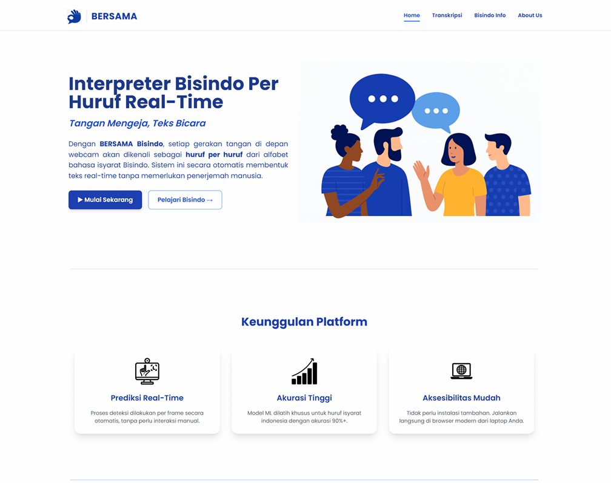
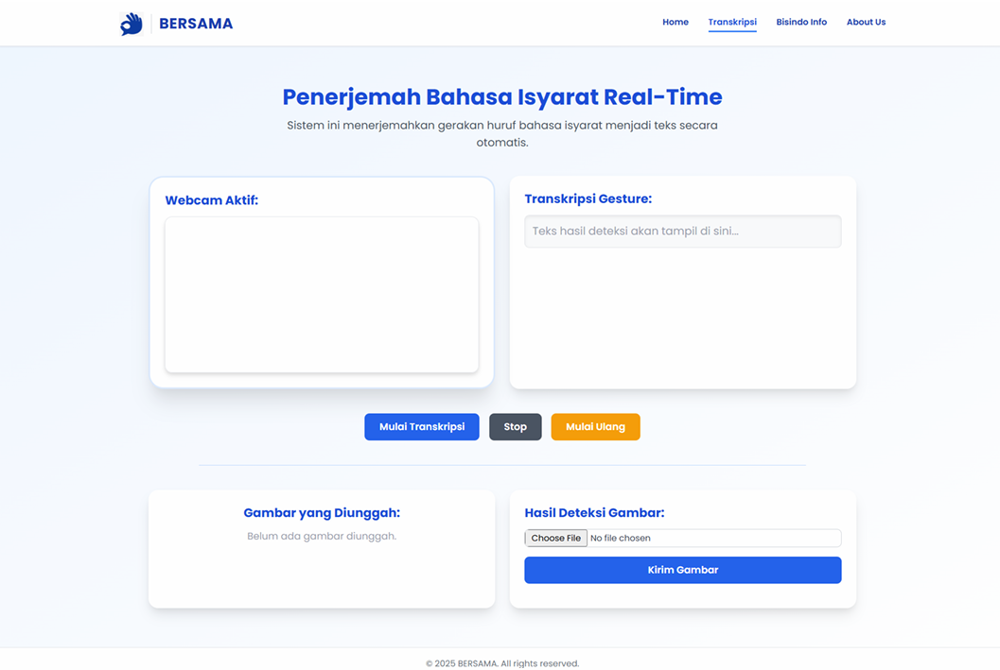
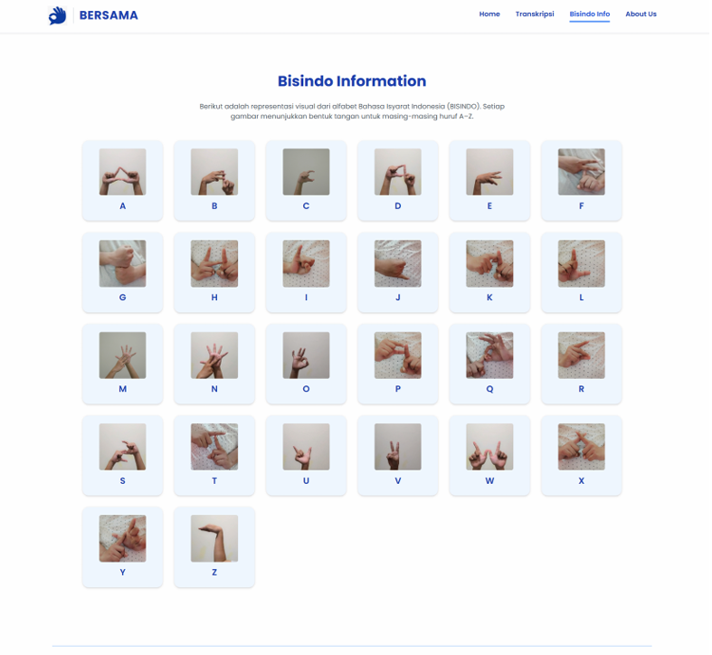

# BISINDO Sign Language Detection

An end-to-end computer vision and deep learning project for recognizing **Bahasa Isyarat Indonesia (BISINDO)** alphabet gestures through a Flask web application.

The system combines **MediaPipe Hands** for landmark extraction, **Fully Connected Neural Networks (FCNN)** for alphabet classification, and **YOLOv8** for person-count validation before prediction.

## Project Overview

The project was developed as a Machine Learning final project at Universitas Airlangga. It focuses on recognizing static BISINDO alphabet gestures and presenting the prediction through an interactive web application.

The original image collection contained **832 BISINDO images**, consisting of 312 publicly available images and 520 self-collected images. After preprocessing, augmentation, and MediaPipe landmark extraction, the modeling dataset was separated into one-hand and two-hand gesture groups.

## Application Screenshots

### Home Page


### Real-Time Transcription


### BISINDO Information Page


## System Workflow

**Image Input → Image Enhancement → YOLOv8 Person Check → MediaPipe Hand Landmark Extraction → 1-Hand / 2-Hand Routing → FCNN Classification → Web Output**

## Model Architecture

Two FCNN classifiers are used because BISINDO alphabet gestures in this project are divided by the number of hands required:

- **1-hand model:** 42 landmark features and 10 output classes
- **2-hand model:** 84 landmark features and 16 output classes

Together, both models cover the 26 alphabet classes used in the project.

## Model Performance

| Model | Test Accuracy | Loss |
|---|---:|---:|
| 1-Hand FCNN | **99.00%** | 0.0031 |
| 2-Hand FCNN | **98.96%** | 0.0486 |

## Web Application

The Flask application includes:

- Home page
- Real-time / uploaded-image translation interface
- BISINDO alphabet information page
- About page

## Technologies

- Python
- TensorFlow / Keras
- MediaPipe Hands
- OpenCV
- YOLOv8 / Ultralytics
- Flask
- Scikit-learn
- HTML / CSS / JavaScript

## Repository Structure

```text
sign-language-detection/
├── app.py
├── predict.py
├── requirements.txt
├── model/
│   ├── model_1hand.h5
│   ├── model_2hand.h5
│   ├── label_encoder_1hand.pkl
│   └── label_encoder_2hand.pkl
├── static/
└── templates/
```

## Running Locally

```bash
pip install -r requirements.txt
python app.py
```

The pretrained YOLOv8 nano weights are downloaded automatically by Ultralytics when they are not already available locally.

## Notes

This repository is a portfolio-oriented version of the original academic project. Training datasets and generated intermediate datasets are not included in the repository.
